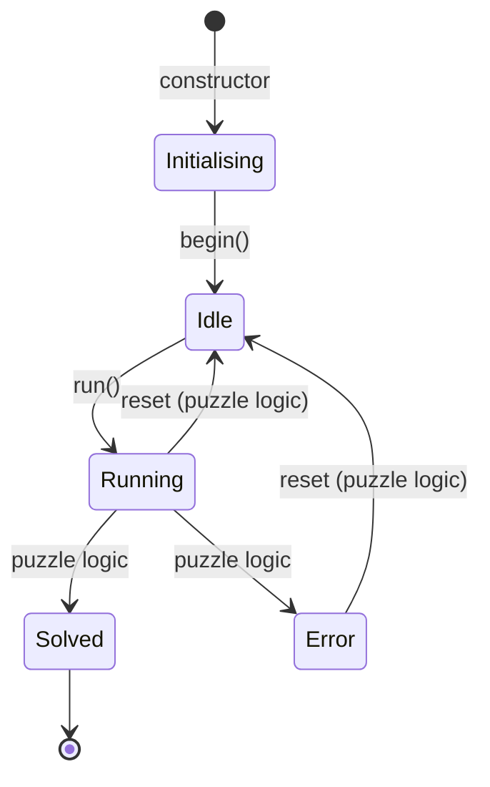
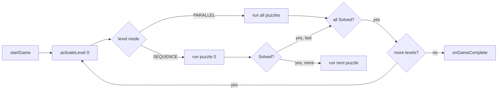

# esp32_escaperoom

An Arduino library for building **escape room puzzles on ESP32**: a hardware-abstracted
engine with a synchronous puzzle state machine, multi-puzzle orchestration, audio,
I/O expanders, displays, LEDs, sensors and Home Assistant integration.

[](LICENSE)
[](library.properties)
[]()

> **Repository visibility.** This repository is currently **private**: it is unpublished and
> accessible only to its owner, for manual review. Flip it to public with
> `gh api -X PATCH /repos/djairjr/esp32_escaperoom -f private=false` only when that review is
> done and the publication is intended. The license below already grants public use of the
> *code*; the note concerns the *repository's* visibility.

---

## Table of contents

- [What it is](#what-it-is)
- [The puzzle state machine](#the-puzzle-state-machine)
- [Multi-puzzle orchestration](#multi-puzzle-orchestration)
- [Supported boards](#supported-boards)
- [Hardware features](#hardware-features)
- [Design notes](#design-notes)
- [Installation](#installation)
- [Quick start](#quick-start)
- [Per-puzzle LED ranges](#per-puzzle-led-ranges)
- [Configuration](#configuration)
- [Home Assistant](#home-assistant)
- [Examples](#examples)
- [Documentation](#documentation)
- [Adding a board](#adding-a-board)
- [License](#license)

---

## What it is

`esp32_escaperoom` is an engine, not a collection of sketches. You subclass
`PuzzleBase`, declare the peripherals in `setupHardware()` and write the puzzle logic in
`update()`; the library supplies everything underneath:

- a **puzzle state machine** (`PuzzleBase` + `PuzzleState`) with a state-change callback;
- a **multi-puzzle manager** (`LogicManager`) that orchestrates one or several puzzles
  through *game levels* that run in parallel or in sequence;
- a **hardware singleton** (`hw`) that auto-detects I2C devices at boot and exposes one
  uniform API — MP3 audio over I2S, PCF8574/PCF8575 I/O expanders, an HT16K33 14-segment
  display, NeoPixel strips, servo, LIS3DH accelerometer, ADS1115 ADC, PCA9685 PWM,
  PN532 NFC, a phone rotary dial and a native rotary encoder;
- a **JSON configuration layer** (`ConfigManager`) that reads configuration from SD card
  or LittleFS and falls back to an **AP-mode captive portal** when there is none;
- **Home Assistant auto-discovery** over MQTT (via ArduinoHA), which replaces the RS485
  inter-puzzle bus of the RP2040 original.

The library is the ESP32 port of **`propmaker_escaperoom`** (Adafruit PropMaker Feather
RP2040), the sibling RP2040 library. The port replaces RS485 with WiFi/MQTT and adds
per-board pin mapping and the configuration layer.

---

## The puzzle state machine

This is the core of the library. Read this section before writing a puzzle.

### `PuzzleState`

Declared in `src/esp32_escaperoom/PuzzleState.h`:

| Value | State | Meaning |
|------:|-------|---------|
| `0` | `Inactive` | Puzzle is not part of the current game / is switched off. |
| `1` | `Initialising` | Default state right after construction, before `begin()`. |
| `2` | `Idle` | Hardware is ready; the puzzle is waiting to be started. |
| `3` | `Running` | The puzzle is live and processing input. |
| `4` | `Solved` | The puzzle was completed. |
| `5` | `Error` | The puzzle hit an error condition. |
| `6` | `Disabled` | The puzzle is administratively disabled. |

```cpp
enum class PuzzleState : uint8_t {
  Inactive = 0,
  Initialising = 1,
  Idle = 2,
  Running = 3,
  Solved = 4,
  Error = 5,
  Disabled = 6,
};
```

`stateName(PuzzleState)` returns the uppercase name (`"INACTIVE"`, `"IDLE"`, …) — use it in
logs. `PuzzleBase::stateName()` returns the mixed-case name (`"Idle"`, …).

### Who drives each transition

The engine owns the frame; **the puzzle owns the outcome**. Exactly three transitions are
driven by the library:

```
constructor                begin()                    run()
Initialising ────────────► Idle ────────────────────► Running
 (default in ctor)      setupHardware() + Idle     setState(Running)
```

```cpp
void begin() {
  setupHardware();
  setState(PuzzleState::Idle);   // ready, waiting (orchestration contract)
}

void run() {
  setState(PuzzleState::Running); // semantic shortcut to start the puzzle
}
```

Everything else is **your** transition table, driven from `update()` by calling
`setState()`:

```cpp
void update() {
  if (getState() != PuzzleState::Running) return;
  // ... read inputs, render feedback ...
  if (sequenceCompleted) setState(PuzzleState::Solved);
  if (fatalCondition)    setState(PuzzleState::Error);
}
```

> **Honest note on the declared-but-undriven states.** `Inactive`, `Error`, `Disabled` and
> the `Initialising` default have **no transition inside the library** — nothing calls
> `setState()` with them except your sketch. They exist as a vocabulary: use them for
> puzzles that need a hard-error state, an administrative kill switch, or a
> "not in this game" state. `Solved` is the only state the engine *reacts to*.

### Lifecycle



- `setState()` is a no-op if the value is unchanged, so it is safe to call every tick.
- Every real transition prints `[PUZZLE <id>] State Change: A -> B` to `Serial` and fires
  the state-change callback if one is registered.
- `run()` is the semantic shortcut for "start this puzzle"; it is what `LogicManager`
  calls when a level activates a puzzle.

### State-change callback

`LogicManager` uses this to react to `Solved` without polling. Register your own with
`setStateChangeCallback()` and user data:

```cpp
typedef void (*StateChangeCallback)(PuzzleBase* puzzle, PuzzleState oldState,
                                    PuzzleState newState, void* userData);
puzzle.setStateChangeCallback(onStateChanged, &myContext);
```

### Puzzle lifecycle contract

| Phase | Method | Called by |
|-------|--------|-----------|
| Register | `LogicManager::addPuzzle(&puzzle)` | sketch `setup()` |
| Initialize | `begin()` → `setupHardware()` | `LogicManager::begin()` |
| Start | `run()` → `Running` | `LogicManager` (level activation) or the sketch |
| Tick | `update()` | `LogicManager::update()` (per level rules) |
| Finish | `setState(Solved)` | the puzzle logic |

When a puzzle is added to a `LogicManager` **with game levels**, `update()` is only called
for the puzzle(s) the current level activates; a `PuzzleBase` that is `Idle` is not ticked.
A `LogicManager` **without** levels ticks every registered puzzle unconditionally.

### Cooperative, non-blocking

`update()` is called in a tight loop. Do not block:

- never `delay()` inside `update()` — the ESP32 task watchdog will bite;
- avoid `while (…)` wait loops; model progress as a state within `Running`;
- `hw.sound().loop()` must be called every iteration to keep audio decoding.

> Caveat in the current release: `PuzzleBase` ships blocking helpers
> (`waitForInput()`, `waitForAnyInput()`) that spin on `millis()`. They exist for
> bring-up and simple sketches; prefer `detectRisingEdge()` / `readInputDebounce()`
> inside a non-blocking `update()`.

### Example-level FSM (`PuzzleEngine`)

A second, **data-driven state machine** ships with the examples:
each `UniversalController*` example carries its own `PuzzleEngine.h` / `.cpp`
(states `IDLE`, `RUNNING`, `INPUT_CORRECT`,
`INPUT_WRONG`, `SOLVED`, `ERROR`, `TIMEOUT`). It interprets a JSON description of a puzzle
(inputs, mode, timeout) at runtime — custom sequence, linear sequence, all-connected and
random modes. It is **not** part of the library `src/`, and it is used by the
`UniversalController` examples. See
[`docs/ARCHITECTURE.md`](docs/ARCHITECTURE.md).

---

## Multi-puzzle orchestration

`LogicManager` is the orchestrator. It manages up to **8 puzzles** and up to **8 game
levels**.

```cpp
class MyManager : public LogicManager {
public:
  MyManager() : LogicManager(/*hwId=*/0, /*isMaster=*/false) {}
  void onGameLevelEnter(uint8_t level) override;   // a level became active
  void onGameLevelExit(uint8_t level) override;
  void onGameComplete() override;                 // the whole game finished
  void onPuzzleSolved(uint8_t puzzleIndex) override;
};
```

### Game levels

A level groups puzzles and declares how they run:

```cpp
enum class GameLevelMode : uint8_t {
  PARALLEL = 0,   // every puzzle in the level runs at the same time
  SEQUENCE = 1,   // puzzles run one after another
};

struct GameLevelConfig {
  const uint8_t* puzzleIds;  // puzzle ids in this level
  uint8_t puzzleCount;
  GameLevelMode mode;
};
```

```cpp
static const uint8_t access[]   = { 1, 2, 3 };   // three puzzles in parallel
static const uint8_t interior[] = { 7, 8, 9 };   // three puzzles in sequence
static const GameLevelConfig levels[] = {
  { access,   3, GameLevelMode::PARALLEL },
  { interior, 3, GameLevelMode::SEQUENCE },
};
manager.setGameLevel(levels, 2);
manager.begin();
manager.startGame();   // activates level 0
```

`startGame()` activates level 0 and calls `onGameLevelEnter(0)`. When a puzzle reports
`Solved`:

- **PARALLEL** — the level is complete when *every* puzzle in it is `Solved`.
- **SEQUENCE** — the next puzzle in the level is started (`run()`); the level is complete
  after the last one.
- When the level completes, `onGameLevelExit()` fires and the next level is activated (or
  `onGameComplete()` if it was the last one).



### Timer

`LogicManager` also carries a global countdown timer that prints onto the display via
`hw.display()`:

```cpp
manager.startTimer(600);          // 10 minutes
manager.getRemainingTime();       // seconds left
manager.stopTimer();
```

### State observation

`LogicManager` sees puzzle completion **twice over**: through the state-change callback
(registered at `begin()`) and through a poll fallback in `update()`. Both funnel into
`handlePuzzleStateChange()`; the poll exists so a puzzle that sets `Solved` without the
callback still advances the game.

---

## Supported boards

Board pin mapping is chosen automatically from the Arduino IDE board macros; boards
without detection need a `-DBOARD_xxx` build flag. Full pin contract:
[`docs/BOARDS.md`](docs/BOARDS.md).

| Board | Detection | Pin file |
|-------|-----------|----------|
| Seeed XIAO ESP32-S3 / Sense / Plus | automatic | `pins/xiao_esp32s3.h` |
| Seeed XIAO ESP32-C3 | automatic | `pins/xiao_esp32c3.h` |
| M5Stack Cardputer | automatic | `pins/cardputer.h` |
| M5Stack StampPLC | `-DBOARD_STAMPLC` | `pins/stamplc.h` |
| Adafruit MatrixPortal S3 | `-DBOARD_MATRIXPORTAL` | `pins/matrixportal.h` |
| Ai-Thinker ESP32-A1S Audio Kit | `-DBOARD_AUDIO_KIT` | `pins/audio_kit.h` |
| VCC-GND Studio YD-ESP32-S3 | `-DBOARD_YD_ESP32S3` | `pins/yd_esp32s3.h` |
| anything else | fallback | `pins/xiao_esp32s3.h` |

The XIAO ESP32-C3 has no DAC, so IoAbstraction (expanders/keypads) does not compile for
it; the library defines `ESP32_ESCAPEROOM_NO_IOABSTRACTION` automatically for that board.
You can also define it yourself to drop the IoAbstraction dependency entirely.

---

## Hardware features

Everything is reached through the `hw` macro (a singleton:
`esp32_escaperoom::Hardware::instance()`).

| Feature | API | Device |
|---------|-----|--------|
| Audio | `hw.sound()` | MP3 over I2S, Helix decoder, `playOnce` / `playLoop` / `playOnceBlocking` / `tone` |
| I/O expanders | `hw.addPcf8574(0x20)` / `hw.addPcf8575(0x21)`, `hw.io()` | PCF8574 / PCF8575 via IoAbstraction |
| Display | `hw.display()` | HT16K33 4-digit 14-segment |
| NeoPixel | `hw.setLight()`, `hw.pixelsExternal()`, `hw.pixelsInternal()` | WS2812 strips |
| Servo | `hw.setActuator(angle)` | servo on PWM |
| PWM | `hw.setAnalogOutput(ch, percent)` | PCA9685 |
| ADC | `hw.readVoltage(ch)`, `hw.readAnalogRaw(ch)` | ADS1115 |
| Accelerometer | `hw.isShaking()`, `hw.isSingleTapped()`, `hw.isDoubleTapped()` | LIS3DH |
| NFC | `hw.createNfcReader()` | PN532 (I2C) |
| Rotary dial | `hw.createRotaryDial(pin)` / `createRotaryDialOptical(...)` | phone pulse dial |
| Rotary encoder | `hw.createEncoder(pinA, pinB)` | quadrature encoder |
| Battery | `hw.readBatteryVoltage()`, `hw.readBatteryPercent()`, `hw.setLowPowerMode()` | LiPo divider |
| Detection | `hw.hasAccelerometer()`, `hasDisplay()`, `hasAdc()`, `hasPwmDriver()`, `hasRtc()`, `hasOled()`, `hasNfc()` | boot I2C scan |

Boot prints a full hardware report (I2C scan, filesystem mount, expanders, audio).

---

## Design notes

### An I2C-first build

A puzzle needs far more inputs and outputs than a board has GPIO pins: buttons, sensors,
locks, relays, LEDs, keypads, a display. The library is designed so that a build can be
wired around **I2C** instead of around the few free pins — two pins can carry the whole
installation:

| Peripheral | Device | Address recognised at boot |
|------------|--------|----------------------------|
| digital I/O | PCF8574 / PCF8575 (through IoAbstraction) | `0x20`–`0x27` (PCF8574A/PCF8575A: `0x38`–`0x3F`) |
| display | HT16K33 14-segment | `0x70`–`0x77` |
| PWM (servos, dimmers) | PCA9685 | `0x40`–`0x47`, `0x4C`–`0x4F` |
| analog input (potentiometers) | ADS1115 | `0x48`–`0x4B` |
| NFC / RFID | PN532 | `0x24` |
| accelerometer | LIS3DH | `0x18`–`0x19` |
| real-time clock | PCF8563 | `0x51` |

`Hardware::begin()` runs `Wire.begin()` and then a full I2C scan, printing every device it
finds; each `hw.hasX()` flag comes from that scan, so a sketch adapts to the hardware that
is physically there. Adding a peripheral costs an I2C address, not a GPIO pin — which is
what keeps a puzzle box buildable when the board has run out of free pins.

---

## Installation

**Dependencies** (Arduino Library Manager):

| Library | Manager name | Version |
|---------|--------------|---------|
| ArduinoJson | `ArduinoJson` | |
| IoAbstraction | `IoAbstraction` | `4.5.3` |
| TaskManagerIO | `TaskManagerIO` | `1.5.2` |
| Adafruit NeoPixel | `Adafruit NeoPixel` | |
| Adafruit LED Backpack | `Adafruit LED Backpack Library` | |
| Adafruit LIS3DH | `Adafruit LIS3DH` | |
| Adafruit BusIO | `Adafruit BusIO` | |
| Adafruit PN532 | `Adafruit PN532` | |
| ADS1115 | `ADS1115_WE` | |
| PCA9685 | `PCA9685` | |
| Servo | `ESP32Servo` | |
| RotaryDial | `RotaryDial` | |
| M5Unified | `M5Unified` | |
| Home Assistant | `home-assistant-integration` (header `ArduinoHA.h`) | |

The IoAbstraction and TaskManagerIO versions are pinned on purpose: the 5.x line of both
does not compile on the ESP32 core 3.x.

**Manual dependencies** — published on GitHub only, they are **not** in the Arduino Library
Manager, so the manager cannot install them:

- **`arduino-audio-tools`** — the audio pipeline (`AudioTools.h`, MP3 over I2S).
  Install from <https://github.com/pschatzmann/arduino-audio-tools>:

  ```
  cd <arduino>/libraries
  git clone https://github.com/pschatzmann/arduino-audio-tools.git
  ```

- **`arduino-libhelix`** — MP3 decoder used by the audio pipeline.
  Install from <https://github.com/pschatzmann/arduino-libhelix> (Sketch → Include
  Library → Add .ZIP Library), or clone it into your `libraries/` folder.

Example sketches additionally use `lvgl`; install it only for the examples that need it
(see [`docs/EXAMPLES.md`](docs/EXAMPLES.md)).

**Library**: clone this repository into your Arduino `libraries/` folder and restart the
IDE. Verify with the smoke test:

```
File → Examples → esp32_escaperoom → Hardware_Tests → LibrarySmokeTest
```

---

## Quick start

```cpp
#include <ESP32EscapeRoom.h>
using namespace esp32_escaperoom;

class MyPuzzle : public PuzzleBase {
public:
  MyPuzzle() : PuzzleBase(/*id=*/1) {}

  void setupHardware() override {
    hw.addPcf8575(0x20);   // 16-bit I/O expander
    hw.io()->pinMode(0, INPUT_PULLUP);
  }

  void update() override {
    if (getState() != PuzzleState::Running) return;

    if (detectRisingEdge(0)) {                 // button on PCF pin 0
      hw.sound().playOnce("/unlock.mp3");
      setState(PuzzleState::Solved);
    }
  }
};

MyPuzzle puzzle;

void setup() {
  hw.begin();          // detects hardware, mounts filesystems, starts audio
  puzzle.begin();      // setupHardware() + Idle
  puzzle.run();        // -> Running
}

void loop() {
  hw.sound().loop();   // keep the MP3 decoder fed (mandatory)
  puzzle.update();     // your logic
  delay(1);
}
```

With several puzzles, hand them to a `LogicManager` instead of calling `update()`
yourself (see [Multi-puzzle orchestration](#multi-puzzle-orchestration)).

---

## Per-puzzle LED ranges

When several puzzles share one NeoPixel strip, each puzzle can claim a window of it and
address LEDs by local index:

```cpp
puzzle.setPixelRange(/*offset=*/0,  /*count=*/10);   // physical LEDs 0-9
other .setPixelRange(/*offset=*/11, /*count=*/8);    // physical LEDs 11-18

puzzle.pixels()->setPixelAndShow(3, PuzzlePixelView::Color(0, 255, 0)); // local LED 3
puzzle.pixels()->setAllAndShow(0);                   // clear the puzzle's window
```

`PuzzlePixelView` maps local indices onto the shared strip; `hasPixels()` reports whether a
range has been assigned.

---

## Configuration

`ConfigManager` resolves configuration in this order: **SD card → LittleFS → AP mode**.

```cpp
#include <esp32_escaperoom/ConfigManager.h>

ConfigManager config;

void setup() {
  config.begin();                      // mounts storage, connects WiFi, or starts the AP
  if (config.isAPMode()) { /* captive portal on http://192.168.4.1 */ }
  // config.devName(), config.devRoom(), config.mqttBroker(), ...
}

void loop() {
  config.handleAP();                   // serve the portal when in AP mode
}
```

The configuration JSON (stored as `/wifi.json`) carries WiFi, MQTT and device identity:

```json
{
  "wifi":   { "ssid": "…", "pass": "…" },
  "mqtt":   { "broker": "192.168.1.10", "port": 1883, "user": "…", "pass": "…" },
  "device": { "name": "escaperoom-puzzle", "room": "sala-01", "puzzle_id": "puzzle" }
}
```

When no configuration is found the device raises the `ESP32-EscapeRoom` access point and
serves a small setup form; saving it writes `/wifi.json` to SPIFFS and reboots. Puzzle
configuration files (one JSON per example) are loaded with
`config.loadPuzzleConfig("/bomb.json", doc)`. Details:
[`docs/CONFIGURATION.md`](docs/CONFIGURATION.md).

---

## Home Assistant

The ESP32 port replaces the RP2040's RS485 bus with MQTT and Home Assistant auto-discovery
(ArduinoHA). A puzzle publishes its state and entities, and the room's automation can drive
it back. See [`docs/HOME_ASSISTANT.md`](docs/HOME_ASSISTANT.md) and the `BombTimer` example
for the full entity set (sensors, lock, buttons, select, numbers, switch).

The integration exists for one reason: to bring the **game automation** (puzzle state, locks,
timers, sequences) and the **room automation** (cameras, lights, sound, doors) under a single
management. With the puzzle registered as one more device of the room, the room can drive the
game and the game can drive the room — no second control system in between, and no separate
place to look at what the installation is doing.

---

## Examples

26 sketches under [`examples/`](examples/) — from a hardware smoke test to a nine-puzzle
nuclear-reactor game. Highlights:

| Example | What it shows |
|---------|---------------|
| `Hardware_Tests/LibrarySmokeTest` | Validates every detected device; start here. |
| `Hardware_Tests/KeypadTester` | Discovers the wiring of an unknown matrix keypad. |
| `BombTimer` | Full product puzzle: keypad/wires/RFID, audio, display, HA entities. |
| `SimonSays`, `Mastermind`, `Cyclone`, `Roulette`, `RadioClock` | Classic game puzzles. |
| `ConnectWires` | Wires plus an ADS1115 voltmeter. |
| `EscapeRoomPhone` | Phone rotary dial and SD-card audio. |
| `UniversalController` | Data-driven puzzle configured by JSON (several FSM modes). |
| `MultiPuzzlesGame` | Nine puzzles across five game levels — the `LogicManager` showcase. |
| `Cardputer_H4CK-OS`, `BombTimer_STAMPLC` | Board-specific builds (M5Stack). |

Full catalog: [`docs/EXAMPLES.md`](docs/EXAMPLES.md). Audio files, SPIFFS images and the
example KiCad project are **not** versioned — each `data/README.txt` lists what to add
locally.

---

## Documentation

| Document | Contents |
|----------|----------|
| [`docs/PUZZLE_STATE_MACHINE.md`](docs/PUZZLE_STATE_MACHINE.md) | The full state machine: every state, transition, callback and orchestration rule. |
| [`docs/ARCHITECTURE.md`](docs/ARCHITECTURE.md) | Layers, hardware abstraction, boot sequence, the example-level `PuzzleEngine`. |
| [`docs/API.md`](docs/API.md) | Reference for `Hardware`, `PuzzleBase`, `LogicManager`, `PuzzlePixelView`, devices. |
| [`docs/BOARDS.md`](docs/BOARDS.md) | Pin contract, the seven board files, adding a new board. |
| [`docs/CONFIGURATION.md`](docs/CONFIGURATION.md) | Config resolution, JSON schema, AP-mode portal. |
| [`docs/HOME_ASSISTANT.md`](docs/HOME_ASSISTANT.md) | MQTT discovery, entity patterns. |
| [`docs/EXAMPLES.md`](docs/EXAMPLES.md) | Every example, its board and what it teaches. |
| [`DEPENDENCIES.md`](DEPENDENCIES.md) | Dependency list, versions and manual install. |

---

## Adding a board

1. Copy the closest file in `src/esp32_escaperoom/pins/` to `pins/<your_board>.h`.
2. Fill in the pin constants (`PIN_I2C_SDA`, `PIN_I2S_*`, `PIN_SD_CS`, `PIN_RELAY`,
   `PIN_NEOPIXEL*`, `PIN_SERVO_PWM`, `PIN_EXTERNAL_POWER`, `PIN_BATTERY_SENSE`, `PIN_IO*`)
   and the `HAS_ONBOARD_*` / `HAS_*` flags declared in the contract.
3. Add a branch to the detection cascade in `PlatformPins.h` (automatic macro, or a
   `BOARD_xxx` flag).
4. Implement `boardInit()` if the board needs vendor initialization (M5Stack boards call
   `M5.begin()` there).
5. Compile at least `LibrarySmokeTest` for the new board.

The full contract is in [`docs/BOARDS.md`](docs/BOARDS.md).

---

## License

MIT — see [`LICENSE`](LICENSE).

Author: **Djair Guilherme da Silva Junior** (Nicolau dos Brinquedos) — <djair.jr@gmail.com>.
