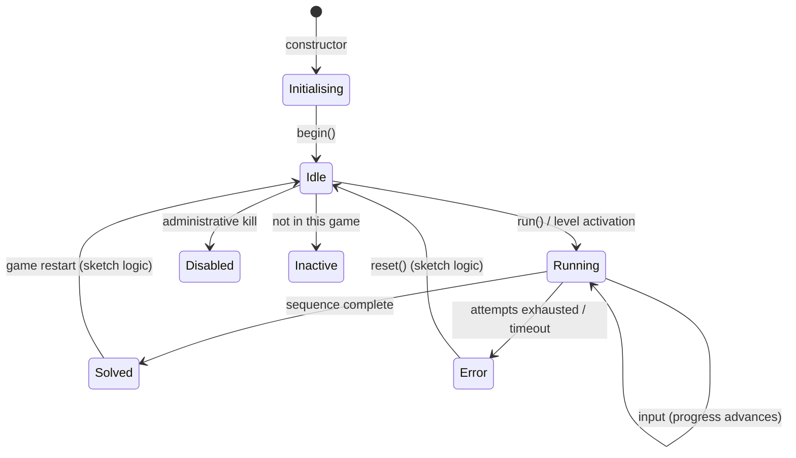

# The puzzle state machine

This document describes, in full, how a puzzle progresses from construction to
completion in **esp32_escaperoom**. It covers two state machines:

1. the **library-level FSM** — `PuzzleState` on `PuzzleBase`, driven by the engine and by
   your puzzle logic, and consumed by `LogicManager`;
2. the **example-level FSM** — `PuzzleEngine`, a JSON-driven state machine shipped inside
   the `UniversalController` examples, which layers a data-configured puzzle on top of a
   `PuzzleBase`.

The library-level FSM is the contract. If you understand only one thing about this
library, understand this.

---

## 1. Library-level FSM: `PuzzleState`

### 1.1 The states

Defined in `src/esp32_escaperoom/PuzzleState.h`:

| Value | Enumerator | Terminal? | Driven by |
|------:|------------|-----------|-----------|
| `0` | `Inactive` | no | your sketch |
| `1` | `Initialising` | no | constructor (default) |
| `2` | `Idle` | no | `begin()` (library) / your sketch |
| `3` | `Running` | no | `run()` (library) / your sketch |
| `4` | `Solved` | effectively yes | your sketch |
| `5` | `Error` | no (recoverable) | your sketch |
| `6` | `Disabled` | no | your sketch |

```cpp
enum class PuzzleState : uint8_t {
  Inactive = 0,
  Initialising = 1,
  Idle = 2,
  Running = 3,
  Solved = 4,
  Error = 5,
  Disabled = 6,
};
```

The values are **not** a progression you must follow step by step; they are a vocabulary.
Only `Initialising → Idle → Running → Solved` corresponds to a path the library itself
takes.

Two name helpers exist:

- `esp32_escaperoom::stateName(PuzzleState)` → `"INACTIVE"`, `"IDLE"`, `"RUNNING"`, … (for
  logs; returns a `__FlashStringHelper*`).
- `PuzzleBase::stateName(PuzzleState)` → `"Inactive"`, `"Idle"`, … (mixed case, static).

### 1.2 Who owns which transition

**The engine owns the frame; the puzzle owns the outcome.** The library performs exactly
three transitions, and only these:

```
          constructor            begin()                run()
     ─────────────────►   ───────────────────►   ───────────────────►
        Initialising              Idle                   Running
     (member initializer)   setupHardware() + setState(Idle)   setState(Running)
```

```cpp
PuzzleBase(uint8_t id) : id_(id), state_(PuzzleState::Initialising) {}

virtual void begin() {
  setupHardware();
  setState(PuzzleState::Idle);       // "ready, waiting" — the orchestration contract
}

void run() {
  Serial.printf("[PUZZLE %d] Manual Start Sequence (run() call)\n", id_);
  setState(PuzzleState::Running);
}
```

Every other transition is **yours**, taken from `update()`:

```cpp
void update() {
  if (getState() != PuzzleState::Running) return;   // the universal guard

  // ... read inputs, drive feedback, advance internal progress ...

  if (puzzleIsComplete()) setState(PuzzleState::Solved);
  if (unrecoverable())    setState(PuzzleState::Error);
}
```

`Solved`, `Error`, `Disabled` and `Inactive` have **no transition inside the library**.
That is deliberate and is documented here so nobody hunts for a missing call: use them as
the semantics your puzzle needs. The engine *reacts* to exactly one of them — `Solved` —
and only when the puzzle is registered with a `LogicManager`.

### 1.3 `setState()` semantics

```cpp
void setState(PuzzleState s) {
  if (state_ == s) return;                     // idempotent — safe every tick
  PuzzleState old = state_;
  state_ = s;
  Serial.printf("[PUZZLE %d] State Change: %s -> %s\n", id_, stateName(old), stateName(s));
  if (stateChangeCb_) stateChangeCb_(this, old, state_, stateChangeCbData_);
}
```

Three properties matter:

- **Idempotent.** Setting the current state again does nothing — no log, no callback. A
  guard `if (getState() == X) return;` inside your logic is therefore also safe.
- **Observable.** Every real change logs one line. On a busy serial console this is your
  FSM trace.
- **Notifiable.** If a callback is registered, it fires **synchronously**, inside
  `setState()`, i.e. inside your `update()`. Do not do heavy work in the callback.

There is no `transition table` object: transitions are expressed as `setState()` calls in
your code. The table below is the canonical one your puzzle should implement.

### 1.4 Reference transition table for a puzzle

| From | Event | To | Action |
|------|-------|----|--------|
| `Initialising` | `begin()` call | `Idle` | `setupHardware()` already ran |
| `Idle` | `run()` or level activation | `Running` | reset progress, play start cue |
| `Running` | correct input | `Running` | advance progress, feedback |
| `Running` | wrong input, attempts left | `Running` | penalize, stay live |
| `Running` | wrong input, attempts exhausted | `Error` | error cue, latch |
| `Running` | sequence complete | `Solved` | success cue, unlock relay |
| `Running` | timer expired | `Error` | timeout cue |
| `Error` | `reset()` from sketch/orchestrator | `Idle` | clear progress |
| `Solved` | game restart | `Idle` | clear progress |
| any | administrative kill | `Disabled` | stop responding |
| any | not part of current game | `Inactive` | stop responding |

### 1.5 State-change callback

```cpp
typedef void (*StateChangeCallback)(PuzzleBase* puzzle, PuzzleState oldState,
                                    PuzzleState newState, void* userData);

void setStateChangeCallback(StateChangeCallback cb, void* userData = nullptr);
```

- It is a **plain function pointer**, not `std::function`: no captures. Use the `userData`
  pointer to reach a context object.
- `userData` must outlive the puzzle — pass the address of a global/static, never a
  stack-local.
- `LogicManager::begin()` installs its own callback on every registered puzzle; a puzzle
  managed by a `LogicManager` should not overwrite it.

### 1.6 Lifecycle



### 1.7 How the engine consumes the FSM

`LogicManager` only cares about `Solved`. It learns about it **twice over**:

1. **Callback** — `begin()` calls `setStateChangeCallback(onPuzzleStateChanged, this)` on
   each puzzle. When a puzzle reaches `Solved`, the callback fires `handlePuzzleStateChange()`.
2. **Poll fallback** — every `LogicManager::update()` compares each puzzle's state against
   `previousStates_[]`; a change into `Solved` also calls `handlePuzzleStateChange()`.

The fallback exists so a puzzle that reaches `Solved` without the callback still advances
the game. Whichever path fires first wins; `handlePuzzleStateChange()` is idempotent
because it re-checks `isLevelComplete()` before advancing.

When a puzzle is solved while a level is active:

```
handlePuzzleStateChange(puzzle)
        │
        ├─ onPuzzleSolved(index)
        ├─ SEQUENCE: start the next puzzle of the level (run())
        └─ if level complete: onGameLevelExit(level) → next level → onGameLevelEnter() 
                              …or onGameComplete() if it was the last level
```

A puzzle in `Idle`, `Initialising`, `Inactive`, `Disabled` or `Error` simply is not ticked
by a level — no error, no log; it is ignored until a level activates it.

### 1.8 The `update()` contract

| Situation | What `update()` must do |
|-----------|--------------------------|
| State is not `Running` | return immediately (guard) |
| State is `Running` | do one tick of work and return — never block |
| Audio in use | `hw.sound().loop()` is called by the sketch's `loop()`, not by `update()` |

**Never** `delay()`, `while`-wait, or do I/O that can stall inside `update()`: the Arduino
`loopTask` runs at priority 1 and the ESP32 task watchdog expects it to yield. The library
ships `waitForInput()` / `waitForAnyInput()` on `PuzzleBase` (they spin on `millis()`);
they are bring-up helpers. In a real puzzle, model the wait as a sub-state of `Running` and
use the non-blocking helpers `detectRisingEdge()`, `detectFallingEdge()` and
`readInputDebounce()`.

### 1.9 Recommended patterns

**Enter-once work.** Do not do "on entering Running" work inside the guard; detect the
edge:

```cpp
void update() {
  static PuzzleState last = PuzzleState::Initialising;
  PuzzleState now = getState();
  if (now != last) { onStateChanged(last, now); last = now; }
  if (now != PuzzleState::Running) return;
  // tick work
}
```

…or, cleaner, override the transitions you need with small private helpers
(`enterRunning()`, `fail()`, `solve()`) that call `setState()` exactly once.

**Latched errors.** Set `Solved`/`Error` once and guard with `getState()`, so the cue does
not replay every tick.

**Reset without side effects.** A reset is `setState(Idle)` plus clearing your own
progress fields; there is no library-level `reset()`. (`PuzzleEngine`, the example FSM, does
expose `reset()` and `restartProgress()` — see below.)

---

## 2. Example-level FSM: `PuzzleEngine`

`PuzzleEngine` is a **second state machine shipped with the examples**: each of the
`UniversalController`, `UniversalControllerMulti` and `UniversalUniqueRFID` example folders
carries its own copy of `PuzzleEngine.h` / `.cpp`. It is *not* part of the library `src/`. The
examples use it to implement a **data-driven** puzzle: the whole puzzle is described by a
JSON file, and `PuzzleEngine` interprets it.

### 2.1 States

```cpp
enum class EngineState {
  IDLE,            // armed, waiting for start()
  RUNNING,         // consuming input
  INPUT_CORRECT,   // transient: a step was accepted
  INPUT_WRONG,     // transient: a step was rejected
  SOLVED,          // sequence complete
  ERROR,           // fatal mismatch / attempts exhausted
  TIMEOUT          // ran out of time
};
```

### 2.2 Public surface

| Method | Purpose |
|--------|---------|
| `begin()` | load configuration, arm |
| `update()` | one tick of the state machine |
| `start()` | arm → `RUNNING` |
| `reset()` | full reset (`IDLE`, progress cleared) |
| `restartProgress()` | clear progress, **stay armed**, no cue, no log |
| `getState()` / `getProgress()` / `getCurrentStep()` / `getTotalSteps()` | introspection |
| `getRemainingTime()` | ms left |
| `isSolved()` / `hasError()` | convenience predicates |

### 2.3 Modes and their process functions

| Mode | `process…()` | Semantics |
|------|--------------|-----------|
| `CUSTOM_SEQUENCE` | `processCustomSequence()` | the sequence is given in JSON |
| `LINEAR_SEQUENCE` | `processLinearSequence()` | inputs must fire 0 → 1 → 2 → … |
| `ALL_CONNECTED` | `processAllConnected()` | all inputs active, order irrelevant |
| `RANDOM` | `processRandomSequence()` | a fresh no-repeat sequence each boot |

---

## 3. Anti-patterns

| Anti-pattern | Why it breaks |
|--------------|---------------|
| `delay()` inside `update()` | blocks the loop task; audio stutters; watchdog reset risk |
| `while (!condition)` in `update()` | same, and `LogicManager` stops ticking every other puzzle |
| Doing work in `setStateChangeCallback` | runs inside `setState()`, i.e. inside your own tick |
| Treating `Error` as terminal without a route back | the engine will not clear it; provide a reset path |
| Assuming the library resets progress for you | it does not; `begin()`/`run()` do not clear your counters |
| Relying on `Inactive`/`Disabled` to be set automatically | nothing in the library sets them; they are yours |
| Capturing locals in a callback | callbacks are function pointers; only `userData` survives |

---

## See also

- [`ARCHITECTURE.md`](ARCHITECTURE.md) — layers and boot sequence.
- [`API.md`](API.md) — every class and method.
- [`../README.md`](../README.md) — orientation and quick start.
